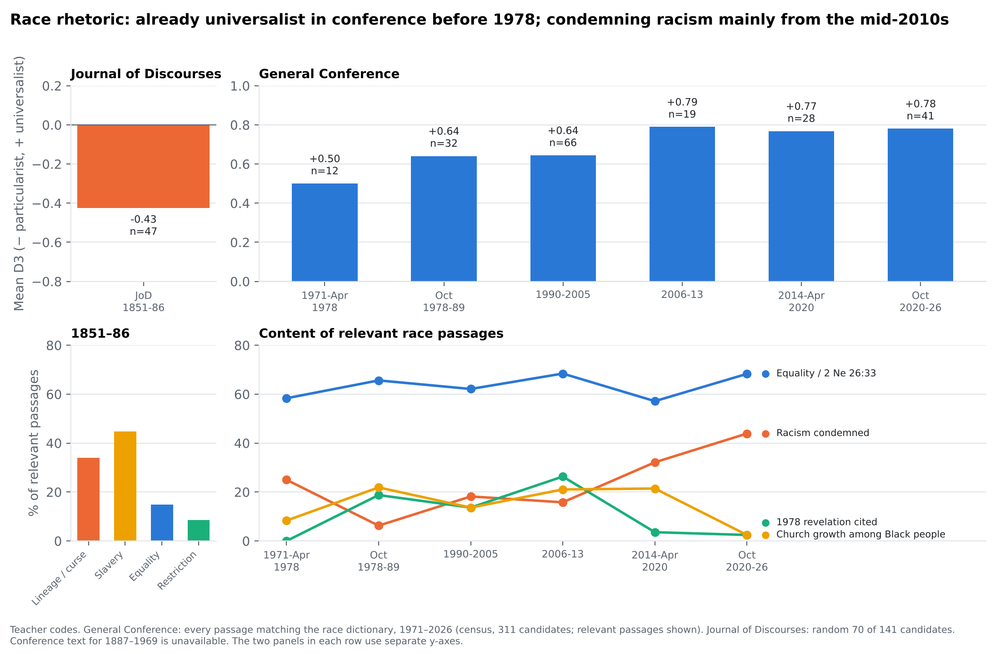
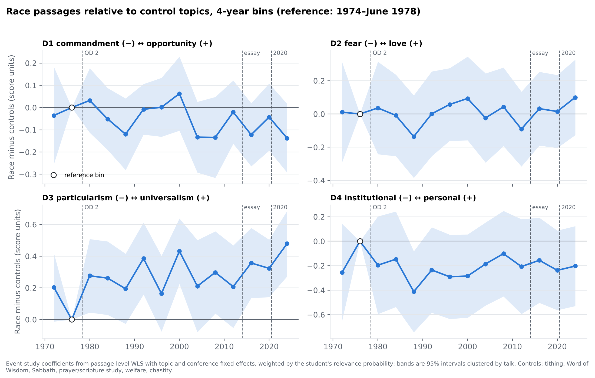
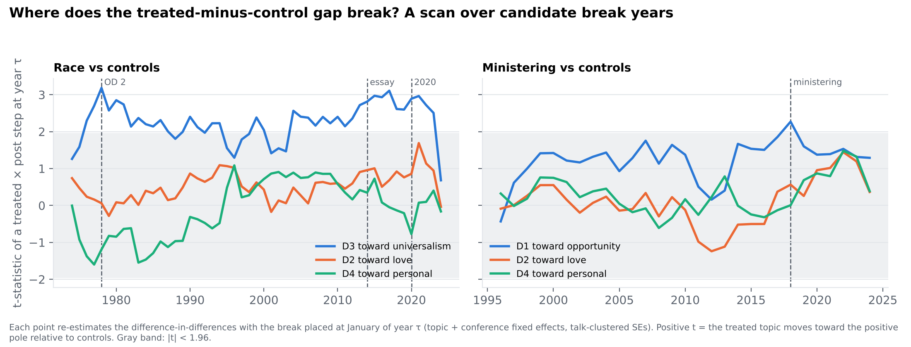
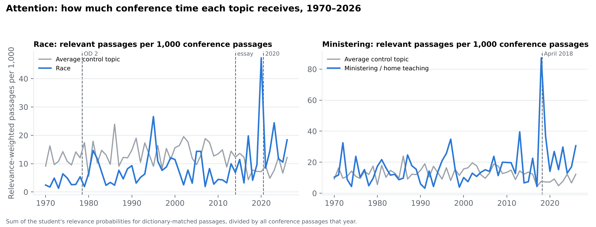
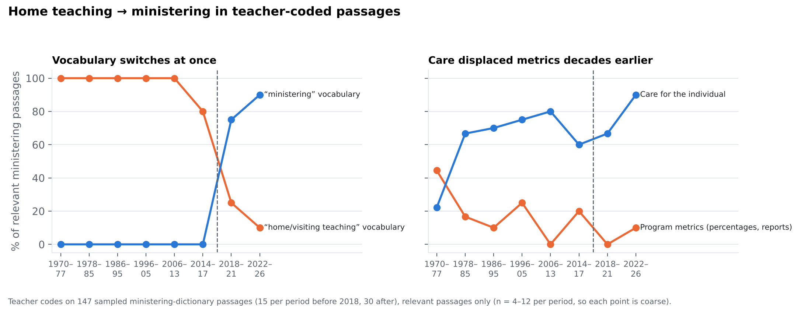
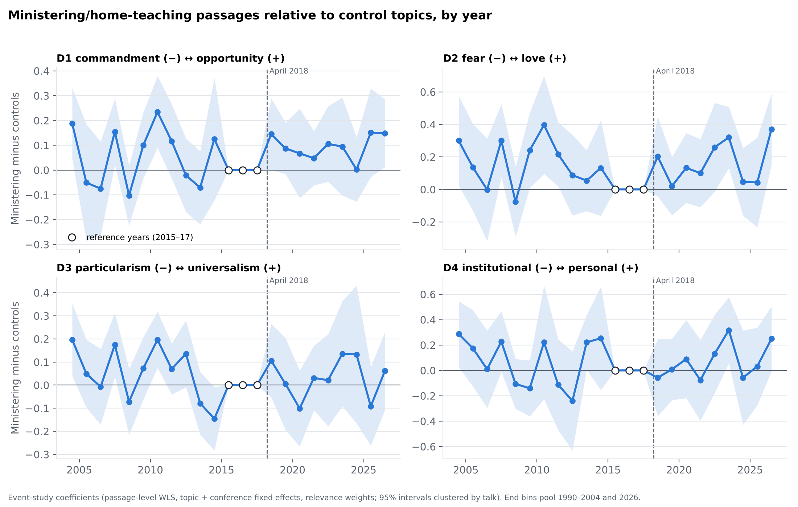
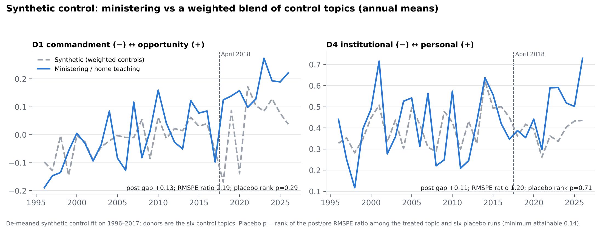
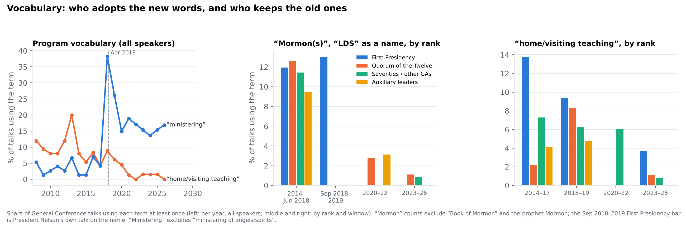
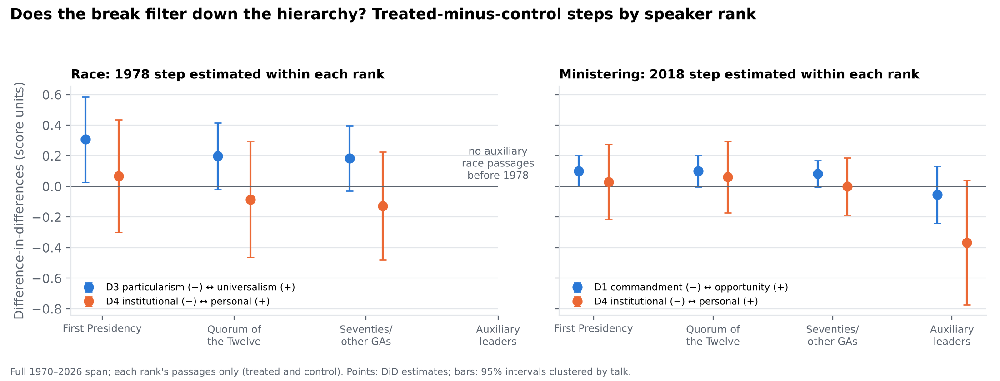

# Talk Before Policy: Rhetoric Around Two Policy Breaks in LDS General Conference, 1851–2026

*Working draft. A companion to Overstreet, "Preserving Policy Through Narrative Transformation: A Computational Analysis of
Mormon Tithing Discourse, 1850–2024." All numbers below are produced by the scripts in `pipeline/` and saved in `out/`.*

## Abstract

The tithing study showed leaders changing how they talked about a policy that stayed fixed. This paper reverses the design
and studies two policies that changed on a known date:
- the June 1978 revelation that ended the priesthood and temple restriction on members of Black African descent (Official
  Declaration 2);
- the April 2018 replacement of home and visiting teaching with "ministering."

I score about 300-word passages of general-authority discourse on four dimensions:
- commandment↔opportunity and fear↔love, carried over from the tithing study;
- particularism↔universalism, after Mauss's *All Abraham's Children*;
- institutional↔personal.

An LLM teacher codes 744 passages blind to speaker and date, including every General Conference passage that matches a
race dictionary. A student model then scores the full corpus. Control topics that neither policy touched supply the
counterfactual: tithing, the Word of Wisdom, the Sabbath, prayer and scripture study, welfare, and chastity. The methods
are:
- difference-in-differences with topic and conference fixed effects;
- event studies;
- a scan over candidate break dates;
- synthetic control;
- placebo topics and dates;
- within-speaker comparisons.

**Three results.**

1. **Vocabulary and attention break sharply at the policy dates; framing does not.**
   - After April 2018, "ministering" replaced "home/visiting teaching" in conference within a conference cycle.
   - Discussion of the program rose about fivefold in 2018, while control topics did not.
   - The four framing dimensions show no ministering shift that control topics do not also show (placebo-topic p = 0.43
     for the largest dimension).
2. **In both cases the framing moved before the policy did.**
   - Race passages in 1971–78 conference talks were already universalist (mean +0.50 on a −1 to +1 scale; Journal of
     Discourses baseline −0.43). They were silent on the restriction and appealed to brotherhood across race.
   - Talk about home teaching had already moved from counting visits to caring for people by the mid-1980s, three decades
     before the program was renamed.
   - The 1978 step in universalism relative to controls is +0.16 against the full 1970–mid-1978 pre-period, but only
     +0.07 (n.s.) against 1970–73. It is better read as continued drift than as a break.
3. **Explicit repudiation of racism came 36–42 years after the policy change, and from the top.**
   - Condemnation of racism appears in 6% of relevant race passages in 1978–89 and 44% in October 2020–2026. The
     changepoint is at 2014 (bootstrap modes 2014 and 2020).
   - The word "racism" appears in only nine conference talks in 55 years. Five of the nine fall between October 2020
     and October 2022, all by the First Presidency or the Twelve.
   - Retired vocabulary lingers longest among the Seventies. The "Mormon" name dropped at every rank at once.

The method passes its own manipulation check: it detects the sharp lexical and agenda breaks that are known to have
occurred. The framing null is therefore informative rather than a failure of measurement.

---

## 1. Introduction

The tithing paper argued that LDS leaders preserve a costly policy by changing the story told about it. Over 175 years,
tithing moved from "commandment" toward "opportunity," and from "fear" toward "love," while the 10% rule stayed fixed.
That design cannot say what happens to rhetoric when the *policy itself* changes. Does the story break when the rule
breaks? Does the change reach every level of the hierarchy, or only the top?

This paper takes two policy breaks with exact dates:

| Case | Policy break | Old rule | New rule |
|---|---|---|---|
| **Race** | 8 June 1978 (letter); sustained 30 Sept 1978 (Official Declaration 2) | Men of Black African descent barred from the priesthood; Black members barred from temple endowments and sealings | "All worthy male members" may be ordained; temple blessings open to all worthy members |
| **Ministering** | 1 April 2018 (General Conference) | Home teaching (men) and visiting teaching (women): monthly visits, reported percentages | "Ministering": needs-based contact, quarterly interviews, no visit counts |

Each case has candidate later breaks:
- **Race:**
  - the December 2013 Gospel Topics essay "Race and the Priesthood," which disavowed the theories once used to justify
    the restriction;
  - the June 2020 First Presidency–NAACP statements and the October 2020 conference addresses on racism.
- **Ministering:** none comparable. A contemporaneous lexical directive serves as a benchmark instead: the August 2018
  instruction to stop using "Mormon" and "LDS" as names for the Church.

The user-facing question is simple: when the policy changed, did the rhetoric change, and did the change filter down the
ranks? The methodological question is whether text-derived rhetoric scores can carry a causal design: treated topics,
control topics, a known break date, and the usual diagnostics.

## 2. Expectations

Four expectations frame the analysis.

- **H1, policy-led rhetoric.** Framing breaks at the policy date. On race, universalism (D3) jumps in October 1978. On
  ministering, opportunity (D1) and personal (D4) jump in April 2018. Both shifts are relative to topics the policy
  did not touch.
- **H2, rhetoric-led policy.** Talk changes first and policy ratifies it.
  - Organizational theory expects this when talk is cheaper than action. Leaders can soften a rationale, stop repeating
    it, or invoke universal brotherhood long before they change a rule that carries institutional and doctrinal cost
    (Meyer and Rowan 1977; Brunsson 1989).
  - Mauss's optimum-tension argument points the same way. A movement under assimilation pressure lowers rhetorical
    tension first and makes structural changes when the tension can no longer be managed by talk (Mauss 1994, 2003).
  - Under H2 the policy break should coincide with little framing change.
- **H3, lagged repudiation.** Ending a policy and repudiating its rationale are different acts. If the institution ends
  the restriction without explaining or disowning it, explicit condemnation should come later, on its own clock.
- **H4, hierarchical diffusion.** A top-down organization should show changes first in the First Presidency and the
  Twelve, then among the Seventies and auxiliary leaders. The alternative is that lexical directives reach all ranks at
  once while substantive reframing stays near the top.

## 3. Data

**Corpus.** The corpus is the same one built for the Christian nationalism project (`ldscn/pipeline/build_corpus.py`):

| Source | Years | Talks | Passages |
|---|---|---|---|
| Journal of Discourses | 1851–1886 | 1,426 | 18,170 |
| Conference Reports (April 1880, October 1897, 1970) | 1880–1970 | 103 | 585 |
| General Conference | 1971–October 2026 | 3,962 | 21,622 |

- Passages are about 300 words, aligned to paragraphs. Procedural passages (sustainings, reports) are excluded.
- Conference text for 1887–1969 is not available in this environment, so the nineteenth century and the modern era are
  never joined in one series or one chart.

**Speaker rank.** Each General Conference talk carries the speaker's rank on the talk date:

| Rank | Who | Talks |
|---|---|---|
| FP | First Presidency | 811 |
| Q12 | Quorum of the Twelve | 1,293 |
| GA | Seventies, Presiding Bishopric, Assistants to the Twelve | 1,440 |
| AUX | Relief Society, Young Women and Primary presidencies, plus men in Sunday School and Young Men presidencies | 419 (372 by women) |

Ranks come from a hand-built apostle and First Presidency table (1847–2026) and from printed callings
(`pipeline/ranks.py`).

**Topics.** Fixed dictionaries span both sides of each break (`pipeline/topics.py`). Each covers old and new vocabulary
("home teach," "visiting teach," "ministering," "watchcare"), so membership does not mechanically follow the break.
- **Race:**
  - Matched directly: race and colour terms, lineage terms (Cain, Ham, Canaan), the restriction and the revelation
    ("every worthy male," "Official Declaration"), and "all are alike unto God."
  - Context-gated: Africa and Brazil terms count only next to race, colour or priesthood words; "prejudice" only next to
    a race or nationality word; "slavery" only next to a race or Southern-states word.
- **Treated topics:** RACE (455 member passages) and MINISTER (1,021).
- **Controls:** TITHING, WOW, SABBATH, PRAYER, WELFARE, CHASTITY. A passage is a control when its primary topic is a
  control and it is not a member of the treated topic.
- **Spillover topics kept out of the control pool:** MISSION, TEMPLE, LAMANITE. The 1978 revelation plausibly changed
  how leaders talked about missionary work, temples and Lamanite lineage.

## 4. Measurement

**Codebook** (`CODEBOOK_BREAK.md`). Four dimensions, each scored −1, −0.5, 0, +0.5 or +1 against written anchors:

| Dim | Negative pole | Positive pole | Origin |
|---|---|---|---|
| D1 | Commandment, obligation, accountability | Opportunity, invitation, privilege | Tithing study |
| D2 | Fear, judgment, curse | Love, compassion, peace | Tithing study |
| D3 | Particularism or hierarchy by lineage, race or nation | Universalism: all alike unto God | Mauss (2003) |
| D4 | Institutional or procedural (programs, reports, channels) | Personal or relational (stories, friendship) | New |

**Relevance and flags.**
- A relevance flag records whether the passage substantively engages its candidate topic.
- Content flags on race passages:
  - L: lineage or curse explanation;
  - R: restriction acknowledged or defended;
  - V: 1978 revelation cited;
  - E: explicit equality or 2 Nephi 26:33;
  - A: racism condemned;
  - G: Church growth among Black people;
  - S: slavery;
  - N: Native American or Lamanite subject.
- Content flags on ministering passages:
  - P: program metrics;
  - C: care for the individual;
  - M: "ministering" vocabulary;
  - H: "home/visiting teaching" vocabulary.

**Teacher codes.** One LLM coder, the same one used in the Christian nationalism project, coded 744 passages. Passages
were shown without speaker, date or source and shuffled across topics. The sample (`pipeline/make_sample.py`):

| Stratum | Passages | Design |
|---|---|---|
| Race, General Conference and Conference Reports | 314 | Every dictionary match (a census) |
| Race, Journal of Discourses | 70 | Random 70 of 141 |
| Ministering | 147 | 15 per pre-2018 period, 30 per post-2018 period |
| Control and spillover | 213 | 3 per topic per period |

Every row carries its stratum size and sample size, so design-weighted means are available.

**Student model** (`pipeline/break_student.py`).
- Dimension scores: ridge regression on word TF-IDF plus gradient boosting on SVD, GloVe and lexicon features. The two
  are averaged and linearly recalibrated to the teacher scale.
- Relevance: a classifier on the same features plus the candidate topic's dictionary hits.

Five-fold cross-validated agreement with the teacher:

| Target | All | Race | Race, relevant | Ministering | Controls |
|---|---|---|---|---|---|
| D1 (r) | 0.51 | 0.47 | 0.40 | 0.49 | 0.56 |
| D2 (r) | 0.75 | 0.76 | 0.81 | 0.73 | 0.69 |
| D3 (r) | 0.63 | 0.68 | 0.71 | 0.36 | 0.26 |
| D4 (r) | 0.77 | 0.74 | 0.70 | 0.78 | 0.78 |
| Relevance (AUC) | 0.82 | 0.79 | — | 0.77 | 0.75 |

- These levels sit in the range of the tithing study's human–model validation: 0.72, 0.77 and 0.54 on its three
  dimensions.
- D3 is weak outside race because it is almost always 0 there, by design.
- D1 is the noisiest dimension, as in the tithing study.
- Where the teacher codes are a census (General Conference race passages), the paper uses them directly. Elsewhere it
  uses student scores weighted by the student's relevance probability.

## 5. Design

The main estimating equation is a passage-level difference-in-differences:

  y<sub>pkc</sub> = α<sub>k</sub> + γ<sub>c</sub> + β·(Treated<sub>k</sub> × Post<sub>c</sub>) + ε<sub>pkc</sub>

- p indexes passages, k topics and c conferences.
- α<sub>k</sub> are topic fixed effects. γ<sub>c</sub> are conference fixed effects, which absorb anything that moves all
  topics in a conference, such as a prophet's style, the length of sessions or world events.
- Observations are weighted by the student's relevance probability for the passage's topic.
- Standard errors are clustered by talk.

Diagnostics (all in `pipeline/break_analysis.py` and `pipeline/break_robust.py`):
1. Event studies:
   - race in 4-year bins over 1970–2026 (reference 1974–June 1978) and 2-year bins for 1970–99;
   - ministering by year over 2004–2026 (pooled reference 2015–17).
2. A **break-date scan**: the DiD re-estimated with the break at every January from 1974 (race) or 1996 (ministering)
   to 2024. If the policy date is the real break, the t-statistic should peak there.
3. **De-meaned synthetic control** on annual topic means, donors = the six controls. Placebo-in-space ranks of the
   post/pre RMSPE ratio give a permutation p-value (minimum 1/7).
4. **Placebo topics**: each control in turn treated at the real date. **Placebo dates**: fake breaks inside the
   pre-period.
5. **Within-speaker** estimates with speaker fixed effects.
6. **Teacher-code** versions:
   - for race, the census of General Conference race passages against design-weighted coded controls;
   - for ministering, the stratified sample;
   - both with stratified bootstrap intervals.
7. **Changepoints** in the race census: optimal partition by year with a BIC penalty, at least 4 years and 8 passages
   per segment, and a talk-level bootstrap of the single-break location.
8. **Attention**: a conference × topic panel of relevance-weighted passages per 1,000 conference passages.
9. **Lexicon**: talk-level use of program and naming terms by rank.

The identifying assumption is that, absent the policy change, treated-topic rhetoric would have moved in parallel with
control-topic rhetoric. Conference fixed effects remove common shocks. The placebo and event-study checks probe the
parallel-trends assumption.

## 6. Results: race

### 6.1 The long arc

Figure 1 (`figs/fig1_race_by_period.png`) shows teacher codes for relevant race passages.



| Period | Relevant passages | Per 1,000 passages | D3 | Lineage/curse (L) | Restriction (R) | Revelation (V) | Equality (E) | Racism condemned (A) | Black growth (G) |
|---|---|---|---|---|---|---|---|---|---|
| JoD 1851–86 (sample) | 47 | — | **−0.43** | 34% | 9% | — | 15% | 0% | 0% |
| GC 1971–Apr 1978 | 12 | 3.2 | **+0.50** | 0% | 8% | — | 58% | 25% | 8% |
| GC Oct 1978–89 | 32 | 7.6 | +0.64 | 3% | 3% | 19% | 66% | 6% | 22% |
| GC 1990–2005 | 66 | 10.4 | +0.64 | 5% | 0% | 14% | 62% | 18% | 14% |
| GC 2006–13 | 19 | 6.0 | +0.79 | 0% | 0% | 26% | 68% | 16% | 21% |
| GC 2014–Apr 2020 | 28 | 12.0 | +0.77 | 0% | 0% | 4% | 57% | 32% | 21% |
| GC Oct 2020–26 | 41 | 20.5 | +0.78 | 0% | 2% | 2% | 68% | **44%** | 2% |

**Nineteenth century.**
- The Journal of Discourses passages are particularist: curse-of-Cain and seed-of-Ham explanations, defences of Black
  servitude, the "white and delightsome" Lamanite trope.
- About half discuss slavery as a racial institution.
- Universalist passages exist (equal justice, rights "irrespective of race or colour"), but they are a minority.

**1970s General Conference.**
- By 1971–78 the register has inverted. Not one of the 12 relevant passages offers a lineage or curse explanation.
- One passage alludes to the restriction, noting that some members "may not now have the priesthood."
- The rest teach that prejudice by race or colour is wrong, or that God loves all His children: equality 58%, racism
  condemned 25%.
- Most of this talk comes from the Seventies and Assistants (8 of 12 passages), not the apostles.
- Race was also rare: about 3 relevant passages per 1,000 conference passages.

So before the policy changed, the conference rhetoric about race was already the rhetoric of the post-1978 Church. The
restriction itself went almost unmentioned. This is the decoupling H2 predicts. Talk had moved to universalism while the
rule stood, and the 1887–1969 gap hides when and how that happened.

### 6.2 Around June 1978

**Table R1. Race minus controls, passage-level DiD** (student scores; topic and conference fixed effects; relevance
weights; SE clustered by talk). Significance: † p < .10, * p < .05, ** p < .01, *** p < .001.

| Specification | D1 opportunity | D2 love | D3 universalism | D4 personal |
|---|---|---|---|---|
| 1971–89 window | −0.03 (0.06) | −0.03 (0.09) | **+0.16 (0.08)*** | −0.14 (0.13) |
| … + speaker fixed effects | −0.10 (0.07) | −0.12 (0.10) | +0.08 (0.08) | −0.18 (0.13) |
| … unweighted | −0.03 (0.06) | −0.00 (0.08) | +0.15 (0.08)* | +0.03 (0.12) |
| … relevance ≥ 0.5 only | −0.03 (0.08) | −0.07 (0.12) | +0.09 (0.09) | −0.25 (0.15) |
| Full 1970–2026, single step | −0.04 (0.05) | +0.02 (0.08) | **+0.22 (0.07)***** | −0.12 (0.11) |
| Full, steps at 1978 / 2014 / 2020 | — | — | +0.18** / +0.08 / +0.08 | — |

Treated passages: 79 race passages in the 1971–89 window, 314 over the full span.

**Table R2. Robustness of the 1978 D3 step.**

| Check | D3 step | p |
|---|---|---|
| Drop race passages that are also Lamanite-dictionary members | +0.17 | .04 |
| Require a strong race term | +0.21 | .01 |
| Leave one control topic out (range over 6) | +0.15 to +0.18 | — |
| Placebo topics (6 controls treated in 1978) | −0.05 to +0.05 | permutation p = .14 (race is the most extreme of 7) |
| **Pre-period = 1970–73 only** | **+0.07** | **.52** |
| Placebo dates inside 1973–77 | −0.13 to −0.37 | — |
| Synthetic control, 1978–89 gap | +0.20 | RMSPE-ratio rank 5 of 7 (p = .71) |
| Teacher census vs coded controls | +0.12 [−0.07, 0.31] | 12 pre, 32 post passages |

The D3 step at 1978 is real in the sense that race passages after 1978 are more universalist relative to controls than
those in 1970–mid-1978. Three diagnostics say it is not a sharp policy-induced break.

1. **The 1974–78 dip.** The pre-period contains a lull. Race rhetoric in 1974 to mid-1978 was less universalist than
   in 1970–73 (Figure 2). Measured against 1970–73 the step is +0.07 and insignificant.



2. **The break scan has a plateau, not a peak** (Figure 3).
   - The t-statistic for a D3 step is above 2 for almost every candidate year from 1977 to 2023. It peaks at 1978
     (t = 3.2), but nearly as high at 2017 (3.1) and 2021 (3.0).
   - That shape is what a steady upward drift produces: any split shows "after" above "before."
   - The event-study coefficients relative to 1974–78 confirm the drift. They are +0.28 in 1978–81, +0.2 to +0.4
     through 2021, and +0.48 in 2022–26.



3. **The teacher census does not break.** Within General Conference the BIC changepoint search prefers no break in D3,
   E or V. D3 rises from +0.50 to +0.64 to +0.78 in steps too small for the noise.

The D4 (institutional↔personal) estimates are negative in every weighted specification (−0.12 to −0.25), though
not significant; the unweighted estimate is +0.03. After
1978 race talk became more administrative and less personal relative to controls. Speakers recounted the revelation
(V), announced temples and stakes in Africa and Brazil (G), and cited the scripture.

### 6.3 What did break: attention, content, and the 2014–2020 repudiation

- **Attention.**
  - Relevant race passages per 1,000 conference passages rose from 3.1 (1971–mid-1978) to 6.6 (late 1978–89), while
    control topics stayed flat (12.9 → 13.0). These are relevance-weighted student counts; the teacher census gives
    3.2 → 7.6.
  - The attention DiD is +0.54 log points in the 1971–89 window (p = .11) and +0.94 over the full span (p = .001).
  - In October 2020–2026, race reaches 20.5 relevant passages per 1,000, six times the 1970s level (Figure 7).



- **Content.**
  - After 1978, race passages gained new subjects: the revelation itself (V: 19% in 1978–89, peaking at 26% in
    2006–13) and Church growth in Africa, Brazil and the Caribbean (G: 22%).
  - Equality language (E) was already at 58% and stayed at 57–68% throughout.
- **Repudiation.**
  - Explicit condemnation of racism (A) is the one content code with a clear changepoint: 2014 by BIC, bootstrap modes
    2014 (23%), 2020 (22%), 2015 and 2017.
  - It runs at 6–18% of relevant race passages through 2013, then 32% in 2014–mid-2020 and 44% after June 2020.
  - Mentions of the revelation (V) fall to 2–4% over the same years. The 2020s frame is not "the revelation opened the
    priesthood"; it is "racism is a sin to be rooted out."
  - The lexical record is starker. The word "racism" or "racist" appears in nine General Conference talks between 1971
    and 2026: McConkie 1979, Maxwell 1995, Ballard and Andersen in October 2017 (after Charlottesville), and five
    talks between October 2020 and October 2022 by Nelson, Oaks and Christofferson.
  - "All are alike unto God" or "black and white, bond and free" appears in no talk before June 1978, about 1% of
    talks from 1978 to mid-2020, and 3.1% after mid-2020.

So H3 holds. The policy changed in 1978; the explicit repudiation arrived in the mid-2010s to 2020. That is 36–42 years
later, and after the 2013 essay had disavowed the old explanations in writing.

## 7. Results: ministering

### 7.1 Attention and vocabulary break at once

- **Attention.**
  - Program talk jumped from about 15 relevant passages per 1,000 conference passages to 87 in 2018, then settled near
    15–30 (Figure 7).
  - In the conference × topic panel, ministering rose from 16.7 to 30.1 per 1,000 (2006–17 vs 2018–26) while controls
    fell from 12.8 to 8.0. The attention DiD is +1.19 log points (SE 0.25, p < .001).
- **Vocabulary.**
  - In teacher-coded relevant passages, "ministering" vocabulary (M) went from 0% in every pre-2018 period to 75% in
    2018–21 and 90% in 2022–26.
  - "Home/visiting teaching" vocabulary (H) fell from 80–100% to 25% and then 10% (Figure 9).
  - At the talk level, "home/visiting teaching" appears in 6.5% of talks in 2014–17 and 7.5% in 2018–19, when speakers
    explained the transition. It then falls to 1.9% in 2020–22 and 1.1% in 2023–26 (Figure 6).



### 7.2 Framing does not break

**Table M1. Ministering minus controls, passage-level DiD.**

| Specification | D1 opportunity | D2 love | D3 universalism | D4 personal |
|---|---|---|---|---|
| 2006–26 window | +0.06 (0.04)† | +0.03 (0.05) | +0.00 (0.04) | +0.01 (0.07) |
| … + speaker fixed effects | +0.09 (0.04)* | +0.13 (0.06)* | +0.01 (0.05) | +0.04 (0.07) |
| … relevance ≥ 0.5 only | +0.06 (0.05) | +0.02 (0.07) | −0.04 (0.05) | +0.01 (0.09) |
| Full 1970–2026 | +0.08 (0.03)** | +0.03 (0.04) | +0.03 (0.03) | +0.04 (0.06) |
| Placebo topics, permutation p | .43 | .71 | 1.00 | .86 |
| Synthetic control, post gap (rank p) | +0.13 (.29) | +0.01 (1.00) | −0.04 (1.00) | +0.11 (.71) |
| Teacher codes, design-weighted DiD | +0.10 [−0.12, 0.34] | +0.12 [−0.15, 0.41] | +0.07 [−0.01, 0.16] | −0.01 [−0.32, 0.30] |

Treated passages: 417 in the 2006–26 window.

The program's stated purpose was a "newer, holier" approach: care rather than counting. On D4 (institutional↔personal),
the dimension that captures exactly that, the 2018 effect is zero in every specification.

**D1 (opportunity).**
- D1 shows a small positive step, +0.06 to +0.09. The break scan peaks at 2018 for D1 (t = 2.3).
- But the six placebo topics produce steps as large at the same date (TITHING +0.06). The event study's post-2018
  coefficients (mean +0.10) barely exceed those of 2004–14 (mean +0.06).
- The pooled 2015–17 reference is itself low. Those years had few ministering passages, and control topics turned
  sharply toward the opportunity/love register in 2014–17.





**Why no break?** Because the reframing had already happened. In the teacher codes:
- **Metrics declined early.** Program metrics (P: percentages, 100% visits, reports) appear in 44% of relevant
  passages in 1970–77 and 0–25% in every later period.
- **Care rose early.** Care for the individual (C) rises from 22% in 1970–77 to 67–80% from 1978 on.
- **Mean D4 turned personal early.** It moves from −0.22 (1970–77) to +0.50 (1986–95) and +0.62 (1996–2005).

By the 1990s, apostles were already telling home teachers that the visit mattered less than the friendship. The 2018
change renamed and re-staffed a practice whose rhetoric had been reframed a generation earlier. It also put far more of
it on the agenda.

**Within speakers.**
- Nine senior leaders (eight apostles and the Presiding Bishop) spoke about home teaching before 2018 and about
  ministering after. All nine moved toward "opportunity", one negligibly: mean D1 change +0.23, D2 +0.15, D4 +0.15.
- With speaker fixed effects and controls, the D1 and D2 steps are +0.09 and +0.13 (p < .05).
- The individual movement is real, but most of it is the same movement those speakers made on tithing, prayer and the
  Sabbath. This is the secular shift toward the opportunity/love register that the tithing study documented.

## 8. Does change filter down the hierarchy?

**Vocabulary: the directive reaches every rank at once** (Figure 6).
- "Mormon(s)," "Mormonism" or "LDS" as a name appears in 12% (FP), 13% (Q12), 11% (Seventies) and 9% (auxiliary) of
  talks from 2014 to June 2018.
- After the August 2018 directive it falls to 0–3% at every rank within a conference cycle. The September 2018–2019
  First Presidency bar is President Nelson's own talk on the name.
- Only five talks used the name after October 2018. One of them, Andersen 2021, explains the change.
- Program vocabulary behaves the same way at the top. The First Presidency and the Twelve stopped saying "home
  teaching" by 2020.
- The laggards are the Seventies. They are the only rank still using the old terms in 2020–22 (6.1% of their talks).
- Seven of the 13 talks that use "home/visiting teaching" after September 2018 are by Seventies, often in personal
  anecdotes ("my home teacher").



**Content: repudiation stays near the top.**
- In October 2020–2026, explicit condemnation of racism appears in:
  - 54% of the First Presidency's relevant race passages (n = 13);
  - 39% of the Twelve's (n = 18);
  - 25% of the Seventies' (n = 8).
- Mean D3 is +0.92, +0.86 and +0.38 respectively.
- The Seventies' race passages in the 2020s divide between two messages handed down by quotation:
  - President Nelson's statement that prejudice by race or nationality "is offensive to our Maker," which they code
    as universalist;
  - President Oaks's teaching that members must give up "ethnic" practices contrary to the gospel, the "gospel
    culture" frame, which they code as mildly assimilationist.
- What filters down is the apostles' language, by citation, and both strands of it.

**Before 1978, by contrast, race talk lived lower in the hierarchy.**
- Eight of the 12 relevant passages in 1971–78 were by Seventies and Assistants to the Twelve.
- By the 2020s, 31 of 41 relevant passages came from the First Presidency and the Twelve.
- The direction of diffusion reversed: from a subject left to lower-ranked speakers to one owned by the top.

**Framing steps by rank** (Figure 8).
- **Race:** the 1978 D3 step is largest for the First Presidency (+0.31, SE 0.14) and similar for the Twelve (+0.20)
  and the Seventies (+0.18). There are no auxiliary race passages before 1978.
- **Ministering:** the D1 step is about +0.08 to +0.10 for the First Presidency, the Twelve and the Seventies.
- Auxiliary leaders became *less* personal relative to their control-topic talk (D4 −0.37, SE 0.21). This is
  consistent with the Relief Society presidency's role in co-announcing and explaining the new structure in 2018–19.



## 9. Discussion

**What breaks and what does not.** Rhetoric has at least three layers, and they respond to a policy break on different
clocks.

| Layer | Timing at the break | Hierarchy pattern |
|---|---|---|
| Lexicon | Changes within one conference cycle | All ranks; the Seventies lag on retired program terms |
| Agenda and attention | Jumps at the break, then partly decays | — |
| Evaluative framing (the four dimensions) | Moves before the policy and keeps moving after it, on secular trends shared with control topics, plus delayed shifts of its own | Explicit repudiation of racism concentrated at the top |

**Talk before policy.**
- Both cases support H2 over H1.
- On race, conference rhetoric was universalist by the early 1970s while the restriction stood. Leaders avoided the
  restriction rather than defending it.
- On ministering, care had displaced counting in home-teaching talk by the late 1980s.
- In both cases the policy change ratified a reframing that was already in place. That is the complement of the tithing
  finding:
  - **Tithing:** narrative transformation preserves a policy that does not change.
  - **Race and ministering:** narrative transformation precedes and prepares a policy that does.
- Mauss's optimum tension fits both. Rhetoric is the cheap adjustment; the rule changes once rhetoric can no longer
  hold the tension.

**Repudiation is a separate act.** Ending a practice and disowning its rationale were separated by decades. The 1978
declaration announced a revelation without explaining the restriction. In August 1978 Elder McConkie told Church
educators to "forget everything" said earlier that contradicted the new revelation. That instruction was given at a
Church Educational System symposium, not at conference. Conference passages did not condemn racism at a higher rate
until the mid-2010s.

**Hierarchy.**
- The organization coordinates *words* perfectly and fast: "Mormon" and "home teaching" disappeared at every rank.
- It does not coordinate *framing* the same way. Explicit repudiation is concentrated among the First Presidency and
  the Twelve, and reaches the Seventies mainly as quotation.
- The pre-1978 pattern is the reverse: the uncomfortable topic was left to lower-ranked speakers.

**Method.**
- **Manipulation check.** The design detects the sharp breaks that certainly occurred:
  - the vocabulary switch (teacher M flag 0% → 82%; talk-level old terms 6.5% → 1.1%);
  - the agenda shock (+1.19 log points);
  - the naming directive (11.6% of talks → 0.7%).
- **The framing nulls are informative.** They are bounded by placebo distributions and come with pre-trend evidence
  that explains them.
- **The scan beats the event study for "is there a break?"** A plateau of significant t-statistics across many
  candidate years flags drift, which a single DiD at the known date would report as an "effect."
- **The pre-period window matters.** With thin pre-1978 data, the 1978 effect halves when the reference years change.

## 10. Limitations

- **One coder.** The teacher codes come from a single LLM coder with no inter-coder reliability yet.
  - The highest-value next step is a human double-code of the 198 relevant General Conference race passages, which
    are a census, and the 147 ministering passages.
  - The student's agreement with the teacher matches the tithing study's human–model agreement, but that is not human
    validation.
- **The 1887–1969 gap.** The century in which race rhetoric inverted is missing. The Conference Reports for 1898–1969
  would supply it, but they were not reachable from this environment.
- **Thin pre-1978 data.** Only 12 relevant General Conference race passages exist in 1971 to mid-1978. Pre-trends for
  race cannot be estimated precisely, and the 1978 estimates depend on the reference window (Table R2).
- **Dictionary candidates.**
  - Membership is by dictionary. The race dictionary matches many false positives ("revelation on priesthood" in D&C
    84 and 107; the Rio Negro), and only 64% of candidates are relevant.
  - Relevance weights and relevance-only specifications address this, but passages that discuss race without any
    dictionary term are missed.
- **Spillover and controls.**
  - Control topics could be indirectly affected, for example if the two-hour Sunday schedule announced in October 2018
    changed Sabbath talk.
  - Leave-one-control-out estimates are stable (race D3 +0.15 to +0.18; ministering D1 +0.05 to +0.07).
  - Control topics thin out in the 2020s: welfare, Word of Wisdom, Sabbath and chastity each have few passages in
    2023–26. Temple and missionary work dominate.
- **Published text.** Conference talks are edited for publication. Spoken versions may differ.
- **Rank coding.** Ranks are assigned by rule from callings and an apostle table. Women leaders before 2018 are
  identified from session and calling.

## 11. Next steps

1. Human validation of the race census and the ministering sample.
2. Add the 1898–1969 Conference Reports to close the gap. Conference rhetoric in the decades of the 1949 and 1969
   First Presidency statements on the restriction would become observable.
3. A third break with a reversal. The November 2015 policy on children of same-sex couples and its April 2019
   rescission give an in-and-out design on the same topic.
4. Replace topic dictionaries with a learned relevance model applied to all passages, so that race talk without
   dictionary terms is counted.

## References

- Brunsson, Nils. 1989. *The Organization of Hypocrisy: Talk, Decisions and Actions in Organizations.* Wiley.
- Bush, Lester E. 1973. "Mormonism's Negro Doctrine: An Historical Overview." *Dialogue* 8(1).
- Mauss, Armand L. 1994. *The Angel and the Beehive: The Mormon Struggle with Assimilation.* University of Illinois
  Press.
- Mauss, Armand L. 2003. *All Abraham's Children: Changing Mormon Conceptions of Race and Lineage.* University of
  Illinois Press.
- Meyer, John W., and Brian Rowan. 1977. "Institutionalized Organizations: Formal Structure as Myth and Ceremony."
  *American Journal of Sociology* 83(2).
- Overstreet, D. "Preserving Policy Through Narrative Transformation: A Computational Analysis of Mormon Tithing
  Discourse, 1850–2024."
- Shanahan, Elizabeth A., Michael D. Jones, and Mark K. McBeth. 2018. "How to Conduct a Narrative Policy Framework
  Study." *Social Science Journal* 55(3).

## Appendix: files and reproduction

Run from the repository root, in this order:

```
python3 -I ldscn/pipeline/build_corpus.py ...      # corpus (see ldscn/)
python3 -I ldsbreak/pipeline/ranks.py ldscn/data/talks.parquet <conference_talks.csv> ldsbreak/data/talk_ranks.csv
python3 -I ldsbreak/pipeline/topics.py ldscn/data/chunks.parquet ldsbreak/data/talk_ranks.csv ldsbreak/data/topics.parquet
python3 -I ldsbreak/pipeline/make_sample.py ldsbreak/data/topics.parquet ldscn/data/chunks.parquet ldsbreak/labels
#   teacher coding -> ldsbreak/labels/break_labels.csv
python3 -I ldsbreak/pipeline/break_student.py ldsbreak/data/topics.parquet ldsbreak/labels <feature_cache> ldsbreak/out
python3 -I ldsbreak/pipeline/break_analysis.py ldsbreak/data/topics.parquet ldsbreak/out/break_scores.parquet \
    ldscn/data/talks.parquet ldsbreak/data/talk_ranks.csv ldsbreak/labels ldsbreak/out
python3 -I ldsbreak/pipeline/break_robust.py ldsbreak/data/topics.parquet ldsbreak/out/break_scores.parquet ldsbreak/labels ldsbreak/out
python3 -I ldsbreak/pipeline/break_figs.py ldsbreak/out ldsbreak/figs
```

The feature cache (word TF-IDF, SVD, GloVe and lexicon features) is built by `ldscn/pipeline/cn_student.py` on its first
run. Conference text is Church-copyrighted and is not committed: `*.parquet` and `*_text.jsonl` are gitignored. The
labels, sample key, speaker ranks and every aggregate output are committed.

| Output | Contents |
|---|---|
| `out/student_cv.csv` | Cross-validated student agreement |
| `out/did_main.csv`, `out/race_multibreak.csv` | DiD tables |
| `out/event_study.csv`, `out/break_scan.csv` | Event studies and the break-date scan |
| `out/synth_summary.csv`, `out/synth_series.csv` | Synthetic control |
| `out/placebos.csv`, `out/robustness.csv` | Placebos, leave-one-out and window checks |
| `out/volume_did.csv`, `out/series_annual.csv` | Attention |
| `out/race_teacher_periods.csv`, `out/race_teacher_rank_period.csv`, `out/race_changepoints.csv`, `out/race_teacher_did.csv`, `out/race_within_speaker.csv` | Race teacher census |
| `out/minister_teacher_periods.csv`, `out/minister_teacher_did.csv`, `out/minister_within_speaker.csv` | Ministering teacher sample |
| `out/rank_did.csv`, `out/lexical_*.csv`, `out/late_*_talks.csv` | Hierarchy and lexicon |
| `out/analysis_log.txt`, `out/robustness_log.txt` | Full printed output |
